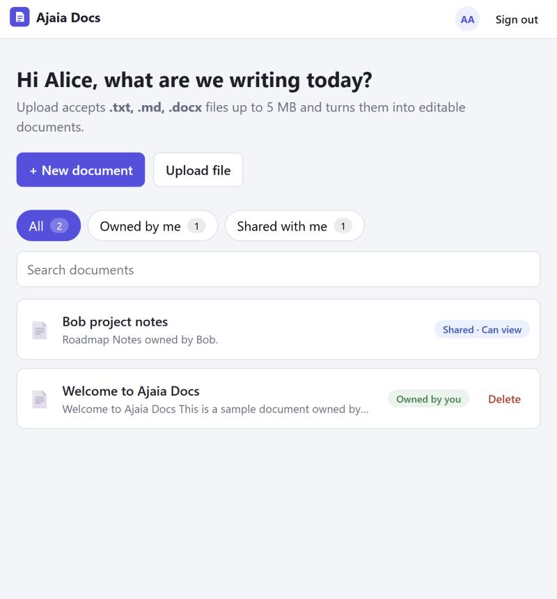
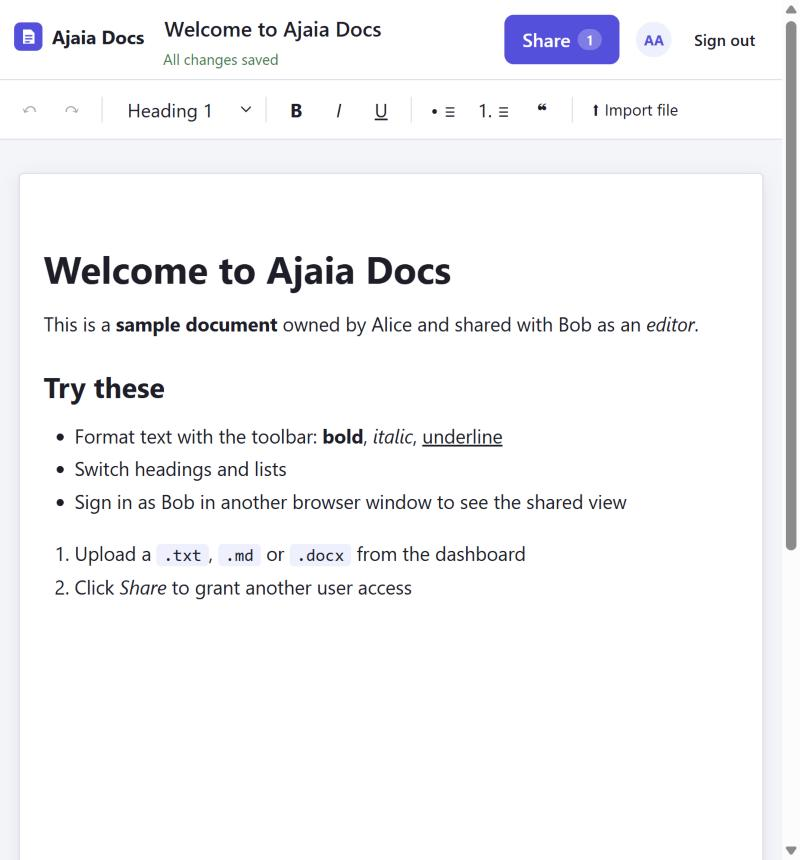
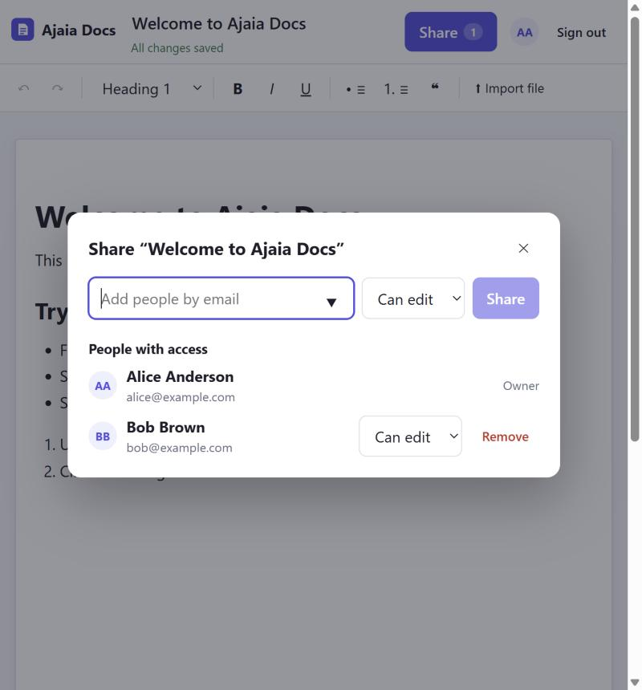

# Ajaia Docs

A lightweight collaborative document editor: create and format documents in the browser, import `.txt` / `.md` / `.docx` files, and share documents with other users as **viewer** or **editor**.

**Stack:** React 19 + Vite · TipTap (ProseMirror) editor · Node/Express 5 · SQLite (better-sqlite3)



| Editor | Share dialog |
| --- | --- |
|  |  |

## Run locally

Requires **Node 20+** (developed on 22). No external services, no API keys.

```bash
cd ajaia-docs
npm run setup     # installs server/ and client/ dependencies
npm start         # builds the client, then serves app + API on http://localhost:3001
```

Open <http://localhost:3001>. The database (`server/data/docs.db`) is created and seeded on first start.

### Development mode (hot reload)

Two terminals:

```bash
npm run dev:server   # API on :3001 (restarts on change)
npm run dev:client   # Vite on http://localhost:5173, proxies /api to :3001
```

### Tests

```bash
npm test             # server (node:test + supertest) then client (vitest)
```

### Docker

```bash
docker build -t ajaia-docs .
docker run -p 8080:8080 -e INSECURE_COOKIES=1 -v ajaia-data:/data ajaia-docs
```

`INSECURE_COOKIES=1` is only needed when running the production image over plain `http://localhost` (production cookies are `Secure`, which browsers only send over HTTPS).

## Test accounts

All seeded users share the password **`password123`**. The login page has one-click buttons that fill them in.

| User | Email | Starting state |
| --- | --- | --- |
| Alice Anderson | `alice@example.com` | Owns the sample "Welcome" document |
| Bob Brown | `bob@example.com` | Has **editor** access to Alice's sample document |
| Carol Chen | `carol@example.com` | Has no access yet |

### Suggested 2-minute review path

1. Sign in as **Alice** → open *Welcome to Ajaia Docs*, edit/format text, rename it (title is at the top). Watch the status line: *Unsaved changes… → Saving… → All changes saved*. Refresh: everything persists.
2. Click **Share**, add `carol@example.com` as **Can view**.
3. Open a second browser profile / private window, sign in as **Carol**: the doc appears under **Shared with me** with a *Shared · Can view* badge; the editor is read-only. Back in Alice's window, switch Carol to **Can edit** – Carol's open page upgrades itself within ~4 s.
4. As Carol (now editor) type something; Alice's window picks it up within ~4 s without a refresh.
5. On the dashboard click **Upload file** and pick a `.md`, `.txt` or `.docx` → it becomes a new editable document. Inside the editor, **⬆ Import file** inserts a file's contents at the cursor.
6. Sign in as Bob and try opening Alice's private doc by URL: you get a "doesn't exist or you don't have access" page.

## Features

| Area | What works |
| --- | --- |
| **Create / edit** | New document, rename (inline title), rich-text editing: **bold**, *italic*, underline, headings 1–3, bulleted & numbered lists, quotes, undo/redo, keyboard shortcuts (Ctrl+B/I/U/Z/Y) and TipTap's default Markdown-style input rules. Debounced **autosave** with a visible status indicator. |
| **File upload** | **Supported types: `.txt`, `.md`, `.docx`, max 5 MB** (stated in the UI). Upload on the dashboard → new document; or import into the open draft at the cursor. Markdown headings/lists/emphasis and Word headings/lists/bold/italic/underline are converted to editable rich text. Images and tables in `.docx` are intentionally dropped (text is kept). |
| **Sharing** | One owner per document. Owner shares by email with **viewer** or **editor** role, can change roles and revoke. Dashboard filters (*All / Owned by me / Shared with me*) and badges (*Owned by you* vs *Shared · Can edit/view*). Viewers get a read-only editor; only the owner can share or delete. |
| **Persistence** | SQLite. Documents are stored as sanitised HTML so formatting round-trips exactly. |
| **Quality** | Server-side validation and clear error messages, HTML sanitisation, optimistic-concurrency conflict handling (409 → in-app resolve banner), 16 server tests + 5 client tests. |
| **Stretch** | Role-based sharing (viewer/editor) and light "live" updates (polling) are included. |

## Status: what's working, what's not

**Working end to end:** everything in the table above, verified by automated tests and by hand in a browser.

**Deployment:** deployed on Render from the included `Dockerfile` / `render.yaml`; the live URL and deploy steps are in [SUBMISSION.md](SUBMISSION.md). The app is a single process, so any Node or Docker host works. On Render's free plan the disk is ephemeral: data resets on redeploy and the demo users/sample doc are re-seeded automatically.

**Intentionally not built** (see [ARCHITECTURE.md](ARCHITECTURE.md) for why):
- Real-time co-editing (CRDT/OT). Concurrent edits are detected and surfaced rather than merged.
- Self-service sign-up, password reset, email invites. Auth is seeded accounts + session cookies.
- Version history, comments, export (PDF/Markdown), tables and images in the editor.
- Rate limiting / CSRF tokens beyond `SameSite=Lax` cookies.

**Next with another 2–4 hours:** (1) Yjs-based real-time collaboration with presence cursors instead of polling; (2) version history with restore (the `version` column and sanitised HTML snapshots make this a small addition); (3) Markdown/PDF export; (4) sign-up + invite-by-email for people who don't have an account yet; (5) component/E2E tests (Playwright) for the editor and share flows.

## API summary

All routes are under `/api`, JSON in/out, session cookie `sid` (HttpOnly, SameSite=Lax).

| Method & path | Purpose |
| --- | --- |
| `POST /auth/login`, `POST /auth/logout`, `GET /auth/me` | Session management |
| `GET /users` | People directory for share suggestions |
| `GET /documents` | `{ owned: [...], shared: [...] }` summaries |
| `POST /documents` | Create (`title`, optional `content`) |
| `GET/PUT/DELETE /documents/:id` | Read / update (`title`, `content`, `version`) / delete (owner) |
| `POST /documents/:id/shares` | Grant or change access `{ email, role }` (owner) |
| `DELETE /documents/:id/shares/:userId` | Revoke (owner), or remove yourself |
| `POST /documents/import` | Multipart `file` → new document |
| `POST /import/parse` | Multipart `file` → `{ title, html }` for insert-into-draft |

## Project layout

```
server/src/   app.js (routes + access logic) · db.js (schema, seed) · importer.js · sanitize.js
server/test/  api.test.js
client/src/   App.jsx · pages/{Login,Dashboard,EditorPage}.jsx · components/{Toolbar,ShareDialog,...}
ARCHITECTURE.md · AI_WORKFLOW.md · SUBMISSION.md · Dockerfile · render.yaml
```
